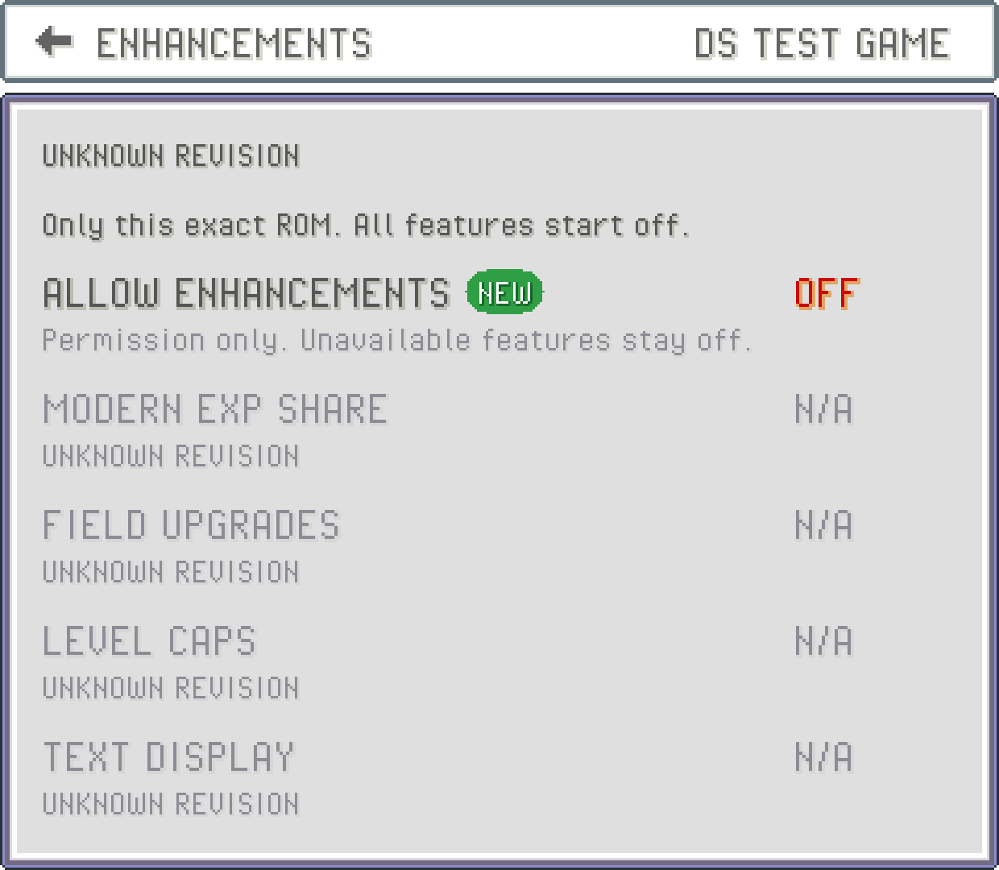

Open your game's library menu and choose `ENHANCEMENTS`, or use `SETTINGS` > `ENHANCEMENTS` in the companion. Each exact ROM has its own settings. Renaming a file keeps them; a different revision or modified ROM gets separate settings. A packed ROM uses the contents of the game inside the archive.

`ALLOW ENHANCEMENTS` starts `OFF`. Turning it on only grants permission for this ROM. It does not enable any feature by itself or bypass verification. `RESET ENHANCEMENTS` turns the permission and all feature choices off for this ROM.

This build prepares shared experience, `FIELD UPGRADES`, `LEVEL CAPS` and `TEXT DISPLAY` settings. Their gameplay implementations are not available yet. They stay `N/A`, even if your ROM is recognized and permission is on. Recognition does not mean a modifier has been tested or approved.

## What the status means

| Status | Meaning |
| --- | --- |
| `CHECKING ROM` | PokeDaisy is reading the complete selected ROM. |
| `KNOWN REVISION` | Its complete checksum matches a listed revision. This is separate from feature availability. |
| `UNKNOWN REVISION` | The header resembles a target game, but the complete ROM does not match a listed revision. |
| `UNSUPPORTED GAME` | This game has no enhancement adapter. Ordinary emulation remains available. |
| `ROM READ FAILED` | Verification could not read the complete ROM. No enhancement is enabled. |
| `NOT IMPLEMENTED` | This feature has no approved implementation in this build. |

Future implementations also need a compatible core, valid code signatures and any required progression information. Missing checks keep the feature off. Changes apply only at a safe point, and loading or resetting the game requires fresh checks.

If enhancement settings cannot be read or saved, the page says so. An unreadable file is kept intact and its choices are not enabled. Reset does not overwrite an unknown settings format.

If another page saved newer choices, your older page cannot overwrite them. Return to the library and reopen `ENHANCEMENTS`, or close and relaunch the game, before trying again.

This page does not edit your ROM or save files. It controls the new enhancement framework; existing gameplay options and manually configured cheats remain separate.
